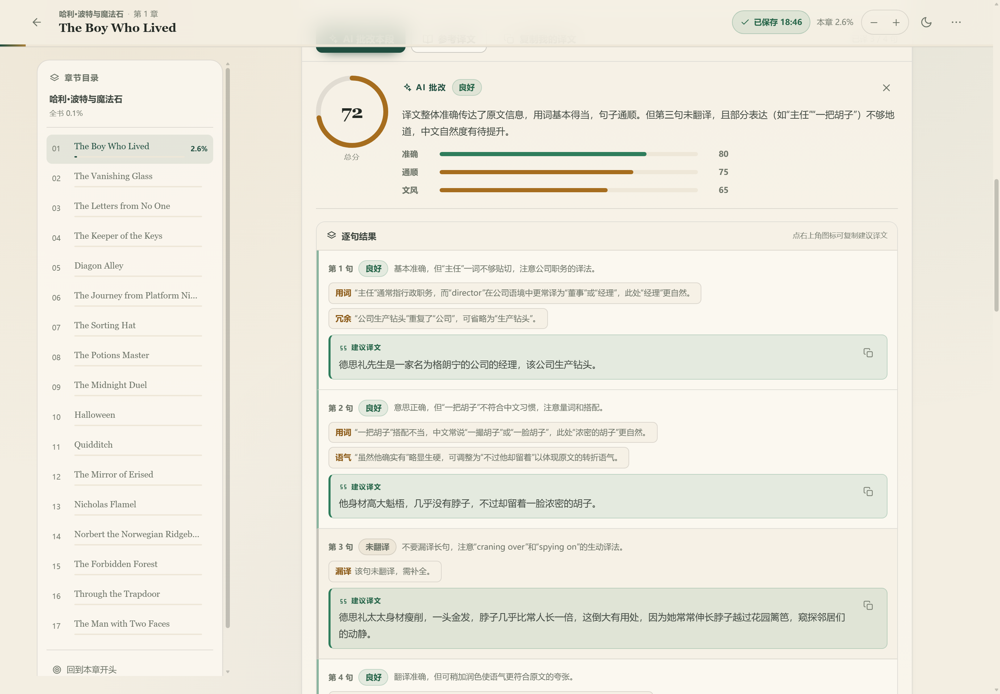

# 逐句译 · Translate Study

本地运行的**逐句英译中练习 + AI 批改**工具。把《哈利·波特》7 本英文 PDF 变成「书 → 章 → 段 → 句」的练习语料，一句一句翻译，再让 DeepSeek 按段落批改你的译文、给出修改意见与参考译文。

> 数据仅保存在你的电脑上；语料仅供个人学习使用，请勿传播原文文本。

## ⚠️ 版权声明

本仓库是个人英语学习项目，**包含《哈利·波特》英文原文语料**（位于 `data/corpus/`，共 7 本 / 199 章 / 80,204 句 / 约 112 万词，由个人持有的 PDF 生成），仅供学习交流。原文版权归 J.K. Rowling 及出版方所有，**请勿用于商业用途或再分发**；如版权方要求，将立即移除相关内容。

代码部分以 [MIT 协议](LICENSE) 开源；`data/corpus/`、`docs/screenshots/` 及 README 中的原文摘录**不在 MIT 协议覆盖范围内**。

> 仓库地址：<https://github.com/Flying-Dog-ux/translate-study>

## ✨ 功能

- **7 本语料**：魔法石 / 密室 / 阿兹卡班的囚徒 / 火焰杯 / 凤凰社 / 混血王子 / 死亡圣器，共 199 章 / 80,204 句 / 约 112 万词，自动切分到句。
- **逐句练习**：英文原句 + 中文输入框，逐段卡片式练习；输入自动保存到服务器，刷新/关机不丢。
- **段落 AI 批改**：一键把整段原句与你的译文交给 DeepSeek，返回：
  - 总分 + 准确 / 通顺 / 文风三维评分 + 鼓励式总评；
  - 逐句判定（优秀 / 良好 / 需改进 / 错误 / 漏译）与具体问题定位；
  - 每句建议译文、整段修改稿、词汇与表达积累、学习建议。
- **参考译文**：先自己翻，再看 AI 参考译文；可对照逐句。
- **进度与复习**：章节/全书进度条、收藏标记、待复习列表；支持导出进度 JSON。
- **阅读体验**：明暗主题、字号调节、桌面双栏 / 手机单栏、键盘快捷键。
- **零外部依赖**：后端只用 Node 内置模块，前端原生 JS，无需 npm install，无需构建。

## 🖼 界面预览

| 书架 | 段落 AI 批改 |
|---|---|
|  |  |

手机端练习（390×844，可调字号 / 抽屉式章节目录）：


## 🚀 快速开始

前置：Windows + Node.js ≥ 20（实测 v24）。仓库已包含生成好的语料，无需 PDF，直接启动即可。

```powershell
git clone https://github.com/Flying-Dog-ux/translate-study.git
cd translate-study
npm start
```

或下载 ZIP 解压后直接**双击 `start.bat`**。浏览器打开 **http://127.0.0.1:5180** 。

### 配置 DeepSeek Key

应用启动时按以下顺序自动查找 `DEEPSEEK_API_KEY`，**Key 只留在本机服务端，不会发送到浏览器**：

1. 本进程环境变量 `DEEPSEEK_API_KEY`
2. 项目根目录 `.env` 文件（可复制 `.env.example` 为 `.env` 填写）
3. Windows **系统变量**（Win+R → `sysdm.cpl` → 高级 → 环境变量 → 系统变量）
4. Windows 用户变量

设置后重启 `npm start`。打开「设置」页可看到 API 连接状态。若未配置，练习与保存仍可用，仅 AI 批改不可用。

## 📖 使用流程

1. 书架选一本书 → 章节目录选一章（或点「继续上次练习」）。
2. 逐句输入中文译文，右上角显示「已保存」。
3. 翻完一段，点「AI 批改本段」→ 稍等几秒查看逐句批改与整段修改稿。
4. 点星标收藏值得回看的段落，在「待复习」里集中复盘。
5. 「设置」页可导出进度备份。

快捷键：`Ctrl/Cmd + Enter` 批改当前段；`Ctrl + ↑/↓` 上一段/下一段；`Esc` 关闭面板。

## 🗂 目录结构

```
translate_study/
├─ server/        # 零依赖 Node 服务：静态资源、语料 API、DeepSeek 批改代理、进度存储
├─ public/        # 原生 JS 单页应用（无构建）
├─ data/corpus/   # 生成的语料：manifest.json + 每章 JSON + 质量报告
├─ scripts/       # Python 语料管线（PyMuPDF）：PDF → 语料；含测试与质量自检
├─ test/          # 后端 node:test 测试（mock DeepSeek）
├─ tests/e2e/     # 端到端验证脚本
├─ docs/          # 项目契约、提示词基线、QA 报告
├─ legacy/        # 早期原型（归档）
├─ LICENSE        # MIT（仅覆盖代码）
└─ package.json
```

## 🔧 常用命令

| 命令 | 说明 |
|---|---|
| `npm start` | 启动应用（默认 127.0.0.1:5180） |
| `npm test` | 后端单元/集成测试（不调用真实 DeepSeek） |
| `python scripts/build_corpus.py --selfcheck` | 重新从 PDF 生成全部语料并自检 |
| `python scripts/build_corpus.py --book hp1` | 只重建某一本 |
| `python scripts/test_corpus.py` | 语料管线单元测试 |

### 环境变量

| 变量 | 默认 | 说明 |
|---|---|---|
| `PORT` | `5180` | 服务端口 |
| `HOST` | `127.0.0.1` | 绑定地址（仅本机） |
| `DEEPSEEK_API_KEY` | — | DeepSeek API Key |
| `DEEPSEEK_BASE_URL` | `https://api.deepseek.com` | API 地址（可指向兼容代理） |
| `DEEPSEEK_MODEL` | `deepseek-chat` | 模型名 |
| `AI_TIMEOUT_MS` | `120000` | 单次 AI 请求超时 |

## 📚 语料来源与重建

语料由本人持有的《哈利·波特》英文 PDF 生成（源 PDF 只读、不修改、不随仓库分发）。生成过程：按字号/缩进识别章首与段落 → 过滤页眉页脚 → 修复跨行连字符 → 英文句子切分 → 质量自检（章节数、词数、句长分布、引号成对等）。

重建语料需要 Python + PyMuPDF：先把 7 本 PDF 放在本地任意目录，修改 `scripts/build_corpus.py` 顶部的 `DEFAULT_SOURCE_DIR` 指向该目录，再执行 `python scripts/build_corpus.py --selfcheck`（详见 [scripts/README.md](scripts/README.md)）。

> 重建语料后需要**重启服务**（manifest 有内存缓存），否则统计与进度分母仍是旧值。

## ✅ 测试与质量

| 验证 | 结果 |
|---|---|
| 独立 QA（[docs/QA-REPORT.md](docs/QA-REPORT.md)） | **PASS**：105/105 检查通过（API 黑盒 50 + 浏览器 E2E 49 + 无 Key 降级 6），0 个 P0/P1 缺陷 |
| 后端测试 `npm test` | 47 / 47 通过（本地 mock DeepSeek，不消耗 API） |
| 语料自检 `python scripts/build_corpus.py --selfcheck` | 79 / 79 检查通过（7 本 199 章 80,204 句） |
| 语料单测 `python scripts/test_corpus.py` | 55 个用例通过 |
| 端到端脚本 | [tests/e2e/](tests/e2e/)（Node 零依赖 + Edge headless CDP，可重复运行） |

真实 AI 联调：段落批改约 5–8 秒返回结构化结果；`/api/reference`、`/api/word` 均已实测。

## ⚠️ 已知限制

- 手机端（≤860px）顶栏的 A-/A+ 收进「更多操作（⋯）」菜单，功能不缺失。
- 语料中有 4 条原文本身超过 120 词的长句（如魁地奇解说），按原文保留不硬切；HP7 墓碑碑文等极少数版式特殊段落按视觉行合并，详见 `data/corpus/quality-report.json` 的 `notes`。
- 单一本机用户设计：进度存于 `data/progress.json`，不支持多端同步；建议定期在「设置」页导出备份。
- AI 批改需要联网访问 DeepSeek；超时/限流会显示可重试的中文提示，不会影响已保存的译文。

## ❓ 常见问题

- **AI 批改失败 / 提示未配置 Key**：到「设置」页查看状态；确认系统变量设置后重启服务。
- **端口被占用**：`$env:PORT=5181; npm start`。
- **PDF 路径变化**：修改 `scripts/build_corpus.py` 顶部的源目录后重跑语料管线，然后重启服务。
- **AI 较慢**：单段批改通常 5–20 秒，章节段落越长越久；页面有加载提示，不会重复扣费提交。
- **手机上调字号**：点练习页右上角「⋯」→「增大/减小正文字号」。

## ⚖️ 开源协议与版权

- **代码**（`server/`、`public/`、`scripts/`、`test/`、`tests/`）：[MIT License](LICENSE)。
- **语料与截图**（`data/corpus/`、`docs/screenshots/`）：《哈利·波特》原文版权归 J.K. Rowling 及出版方所有，仅限本机个人学习，不得再分发或商用，不包含在 MIT 协议内。
- 本项目为个人英语学习工具，与 J.K. Rowling、华纳兄弟及出版方无任何关联。

